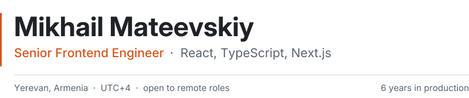

<picture>
  <source media="(prefers-color-scheme: dark)" srcset="assets/header-dark.svg">
  
</picture>

I've spent 6 years shipping production React and TypeScript products: a cross-platform desktop messenger at amoCRM, real-time games at VK, and now a B2B SaaS platform for PC gaming clubs. I like owning a product area end to end: architecture, performance, CI/CD and the details users feel.

 

<picture>
  <source media="(prefers-color-scheme: dark)" srcset="assets/stack-dark.svg">
  
</picture>

### Selected work

| Product | What I did |
|---|---|
| **PC gaming club platform** 2024 – now · NDA | Lead the frontend of 4 apps on one shared architecture: admin panel, operator desk app, customer account, landing. Typed event bus instead of prop drilling, WebSocket-driven queues for live updates. Lighthouse Performance 98 · LCP 0.5 s · zero Sentry errors over two weeks in production |
| **amoCRM desktop messenger** 2022 – 23 · amoCRM | Built the Electron app for Windows, macOS and Linux and reworked message storage in IndexedDB. Memory cut from 300 MB to 50–70 MB |
| **Gatto, real-time VK game** 2022 – 23 · VK | Led a team of 6, designed the frontend and part of the backend, set up code review and mentored 2 junior developers. React · WebSocket · Storybook |

### Contact

[mikhailmateevskiy@gmail.com](mailto:mikhailmateevskiy@gmail.com) · [Telegram](https://t.me/d6f6f6e6) · [LinkedIn](https://www.linkedin.com/in/mikhailmateevskiy)
